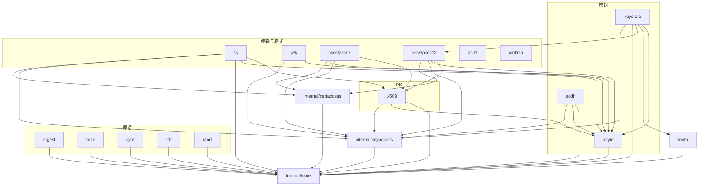

# 项目架构

本文档描述 `tongsuo-go` 的整体架构、目录结构、构建依赖与运行模型。开发规范见
[development-guide.md](development-guide.md)，测试规范见 [testing-guide.md](testing-guide.md)。

---

## 1. 项目概述

`tongsuo-go` 是基于[铜锁 (Tongsuo)](https://www.tongsuo.net/) 的 Go 国密算法封装库，
通过 cgo 直接调用铜锁原生库，为 Go 开发者提供**符合 Go 语言惯例**的国密算法接口。

- **模块路径**：`github.com/blue-cloud-net/tongsuo-go`
- **参考设计**：[blue-cloud-net/tongsuo-csharp](https://github.com/blue-cloud-net/tongsuo-csharp)
  （.NET 国密封装库）的三层架构与文档体系
- **定位**：**全新独立实现**，与官方
  [tongsuo-project/tongsuo-go-sdk](https://github.com/tongsuo-project/tongsuo-go-sdk)
  并存，不复用其代码；但其 cgo/shim 构建思路、子包划分、线程锁与静态链接约定作为实现参考
- **底层依赖**：铜锁 (Tongsuo) **8.4.0+**（Apache-2.0；固定验证 8.4.0 / 8.5.0）
- **授权**：Apache-2.0（工作区 `LICENSE`）

### 1.1 API 设计取向

- **形态走 Go 惯例**：实现标准库接口（`hash.Hash`、`cipher.Block`、`cipher.AEAD`）、
  返回 `(T, error)`、按子包组织
- **同时提供 CLI 式单一入口**：在标准接口之外，每个算法域还提供「算法名 + 输入 → 输出」
  的按名分发入口（如 `digest.Sum("SM3", data)`、`sym.Encrypt("SM4-CBC", key, iv, data)`），
  对齐铜锁 `openssl` 命令行的使用形态
- **命名语义对齐 C# 参考项目**：算法相关命名与语义遵循 C# 思路（如 `SM3`/`SM4`/`SM2`
  相关概念），不强制与官方 SDK 同名
- **一次性便捷函数**：在标准接口之外，提供直接可用的快捷方法（如 `digest.SumSM3`）

---

## 2. 三层架构概览

```
API 层（16 个顶级包：meta / digest / mac / sym / asym / ecdh / kdf / rand /
        keystore / x509 / tls / asn1 / jwk / pkcs/* / xml-rsa）
    ↓ 调用                          ← 仅此层可被外部 import
核心层（internal/core/）          ← 句柄/上下文包装，生命周期与所有权管理
    ↓ 调用
绑定层（internal/native/）        ← cgo + 内嵌 C shim，直接映射铜锁 C 函数
```

- 严格分层，**禁止跨层调用**：API 层不得直接调用绑定层；绑定层不得包含业务逻辑
- 依赖方向**单向向下**，各层边界清晰，便于测试与替换
- API 层内部：`ecdh → asym`（加载 `asym` 密钥对象）、`x509 → asym`（公钥/私钥接口）、
  `tls/jwk/pkcs7/pkcs12 → x509` + `asym`；算法原语包只依赖 `internal/core`，不互相依赖
- **唯一例外（`0.5.0` 起）**：`digest` / `mac` / `sym` / `kdf` / `asym` / `x509`
  → `meta`。`meta` 是**形态词汇的叶子包**（只依赖 `internal/core`），提供
  `Source` / `Sink` / `Encoding` / `Format` / `Passphrase`，供各原语包的「CLI 式
  形态入口」复用；该依赖**单向、无环**，不构成跨层调用



- `asym` / `xml/rsa` 不认识 `ecdh` / `x509`；依赖方向单向，无环
- `tls` / `meta` 均**不**直接 import `internal/native`，统一经 `internal/core`

---

## 3. 各层职责

### 3.1 绑定层（`internal/native/`）

- **只做**铜锁 C 函数的 cgo 声明与薄包装，不含任何业务逻辑
- 函数名与铜锁原生 C 函数名完全一致（如 `EVP_DigestInit_ex`、`EVP_sm3`）
- 内嵌 `shim.c` / `shim.h` 解决 Go 无法直接使用的 C 宏、可变参数函数与**回调桥接**
  （如 BIO 读写、TLS 回调），shim 包装函数统一加 `X_` 前缀（如 `X_EVP_Digest`）
- 按功能域拆分 Go 绑定文件（对应 C# `partial class` 按功能拆文件的思路，Go 用文件名拆分）：
  `binding_digest.go` / `binding_cipher.go` / `binding_pkey.go` / `binding_bio.go` /
  `binding_ssl.go` / `binding_x509.go` / `binding_pkcs.go` / `binding_ocsp.go` /
  `binding_hmac.go` / `binding_kdf.go` / `binding_rand.go` / `binding_error.go` /
  `binding_version.go`（共 13 个；PEM/DER 相关函数聚合在 `binding_x509.go`）
- 原生调用失败由**核心层**通过 `ERR_get_error()` 捕获错误码，本层不处理错误语义

### 3.2 核心层（`internal/core/`）

- 将铜锁非托管句柄（如 `*C.EVP_MD_CTX`、`*C.EVP_PKEY`）封装为 Go 对象，
  管理生命周期与所有权
- `handle` 基类：`owned` 所有权字段 + 显式 `Close()` + `runtime.SetFinalizer` 兜底
- `OpError` 错误类型：携带 `ERR_get_error()` 错误码，对应 C# `OpenSSLCryptoException`
- 上下文类型：`DigestCtx` / `CipherCtx` / `PKey` 等，封装原生对象的完整操作流程
- 统一处理 OpenSSL 线程锁初始化与需要时的 `runtime.LockOSThread()`

### 3.3 API 层（公开导入面）

对外暴露的公共 API 是**单层扁平**的 **16 个顶级包**（`crypto/` 整目录与 `key/` 已在包结构重构中取消）：

| 分组 | 包 | 职责 |
|------|----|------|
| 元信息 | `meta` | 版本 / 构建信息 / 错误码解析 / 算法枚举（只查询，不持有句柄） |
| 算法原语 | `digest` `mac` `sym` `kdf` `rand` | 摘要 / 消息认证码 / 对称加解密 / 密钥派生 / 随机数 |
| 密钥 | `asym` `ecdh` `keystore` | 非对称密钥与运算 / 密钥协商 / 密钥元数据、存储与轮转 |
| PKI | `x509` | 证书 + CSR + CRL + OCSP + 链验证（**单包**） |
| 传输 | `tls` | TLS / NTLS 客户端与服务端 |
| 格式 | `asn1` `jwk` `pkcs/pkcs7` `pkcs/pkcs12` `xml/rsa` | DER viewer / JWK / PKCS#7 / PKCS#12 / .NET XML |

- 每个包**自带 `*_test.go`** 测试文件（见 [testing-guide.md](testing-guide.md)），并尽量提供
  `example_test.go` 与 `*_tongsuocli_test.go`（CLI 对拍，`//go:build tongsuocli` 隔离）
- 不直接调用绑定层，只通过核心层对象操作
- **职责边界**：算法原语与「按算法名分发」的应用入口同包（如 `digest.Sum("SM3", …)`
  与 `digest.SumSM3(…)` 并存）；ASN.1 / PKCS / TLS / 格式转换等组合层包与算法包平级
- **公开签名不得出现 `internal/` 类型**：这是重构后的硬约束（原先 `*core.PKey` /
  `*core.Digest` / `*core.KeyParams` / `*core.Certificate` 等泄漏到公开签名的 12 处均已收敛）

#### 跨包取原生句柄（`internal/keyaccess` / `internal/certaccess`）

API 层内部存在必须先拿到 `*core.PKey` 才能工作的场景（如 `ecdh` 对 `asym` 密钥做
`EVP_PKEY_derive`，`x509` 设置证书公钥 / 签名）。为兼顾「不泄露内部类型」与「不多一次编解码」，
采用**结构化接口断言**而非注册表：

- `asym` 密钥的**具体类型一律非导出**（`*privateKey` / `*publicKey` …），对外只返回
  `PrivateKey` / `PublicKey` 接口；具体类型上实现导出方法 `CorePKey() *core.PKey`
- 该方法**不出现在任何导出接口中**（`asym.Key` / `PrivateKey` / `PublicKey` 均不含它），
  因此不进公开 godoc
- `internal/keyaccess` 只声明形状 `interface{ CorePKey() *core.PKey }` + `PKey(v any) (*core.PKey, bool)`
  并做类型断言：**无注册表、无 `init()` 顺序依赖、无全局状态**；`asym` 也不需要 import 它
- **为何优于反向注册表**：无全局可变状态、无 `init()` 顺序依赖、无并发写入，且契约由类型系统
  隐式校验——改签名会在断言处立刻暴露
- 当前消费方：`ecdh`、`x509`、`tls`、`jwk`、`keystore`、`pkcs/pkcs12`；
  `0.7.0` 已新增 `pkcs/pkcs7` 消费方，签名/解密经该桥接取私钥，不增设桥接。
  拿到句柄后**必须**用
  `EVP_PKEY_dup` 复制，保证两侧生命周期独立（否则 `asym` 侧 `Close()` 后消费方即为悬垂指针）
- 验收：`go doc -all ./asym` 输出中不得出现 `CorePKey`；`internal/` 路径规则保证外部模块无法 import
- **已接受的残余瑕疵**：外部包可写匿名接口断言 `k.(interface{ CorePKey() *core.PKey })` 并调用
  成功，但拿到的 `*core.PKey` 无法被使用——外部模块 import 不到 `internal/core`，**拿到也用不了**。
  若要连这点也消除，唯一替代是「DER 往返」（`MarshalDER` → `d2i_PrivateKey`），代价是每次加载一次
  编解码，已评估不采用

证书句柄走同构的 `internal/certaccess`：`Certificate(v any) (*core.Certificate, bool)`
供 `tls` / `pkcs/pkcs7` / `pkcs/pkcs12` 取句柄，反向的 `Wrap(*core.Certificate)` 用
**DER 往返**产出 owned 副本（因此 `x509.Certificate.CoreCertificate()` 是**已接受的残余**：
方法虽在 godoc，但外部模块无法 import `internal/core`，拿到也用不了；且 owned 副本语义与
`tls.peerCertificateChain` 声明的契约「每个返回的证书由调用方各自 `Close`」一致）。

#### `0.9.0` TLS / NTLS 连接模型（已发布，2026-11-06）

API 的 `config.go` 固定配置和选择规则，`state.go` 提供 DER 值快照；core 的
`ssl_config.go` 编排参数与每连接回调，`ssl_io.go` 管理独立读写与原生错误。
绑定层的 `binding_ssl_handshake.go` / `ssl_handshake.c` 仅桥接原生接口与回调。

- `Protocol` 显式选择 TLS/NTLS/服务端混合端口；SNI 在 ClientHello 阶段选择完整配置或 TLS/NTLS 凭证。NTLS 按双身份切换，签名/加密中间链合并去重为线上的共享池；状态按实际协商协议记录。
- `tls.Client` 包装已连接 TCP，`Server.Accept` 惰性构造；首次 I/O 自动握手，`NewListener.Accept` 保持自动握手。原生构造成功后持有凭证引用，密钥先经 keyaccess Dup，证书经 certaccess；源凭证在构造/选择期间必须有效。
- 独立 readMu/writeMu 序列化同方向操作，ioMu 仅保护单步 SSL 调用；释放 ioMu 等待 socket 就绪，让另一方向推进。同一 SSL 对象不会同时被两个原生调用访问。
- 每次 SSL 调用、SSL_get_error 与完整 ERR 队列采集在同一 OS 线程；原生错误不在调用方 goroutine 重新读取。独立读写 deadline 不互相清空，握手取两者较早值。
- C ex_data 只持有 cgo.Handle 整数 ID；每连接所选 ctx 在 SSL_free 回调释放。读缓冲在重试期间 pin，写缓冲复制到 C 并在成功/SSL_free 清零释放；原生写入开始后失败即禁止再次写入。混合模式的 TLS 版本范围在 ClientHello 选择时与 NTLS 范围分离。
- Stop 先拒绝新操作并 shutdown socket，Close 等 inflight 归零后释放 SSL/fd；Handle 释放函数在显式 Close、构造失败及 finalizer 路径均关闭 fd 副本。ctx.Close 与 SSL_new 通过读写锁隔离。
- VerifyNone/VerifyReport/VerifyStrict 分别表达不验证/失败继续/失败终止；ClientAuth 独立请求客户端证书。自定义验证错误始终终止；状态分别表达握手完成与未验证/通过/失败，复制证书及失败信息，不暴露原生资源。
- 配置构造后不可修改，选择回调可能并发执行且不得重入同一连接；基础组受限时，所选配置须显式指定组。示例默认 Report；0.10.0 接入 RFC 8998 严格配置、事件流、trace/keylog 与 SCT 快照。

#### tls 包公开 API（v0.2.0+）

`tls/` 在 v0.2.0 引入 ctx 友好的握手与错误分类 API，公共符号：

- 连接入口：`DialContext(ctx, network, addr, cfg)` 同时驱动 TCP 拨号与 TLS/NTLS
  握手受同一 ctx 控制；`Dial` 退化为 `DialContext(context.Background(), …)` 薄包装，
  保持源代码兼容
- 握手：`(*Conn).HandshakeContext(ctx)` 在 goroutine 内执行握手，ctx 触发时通过
  `SetDeadline` + 关闭 raw socket 唤醒在途 `SSL_read` / `SSL_write` 等待；
  `(*Conn).Handshake()` 是 `context.Background()` 包装
- 对端证书：`(*Conn).PeerCertificates()` 返回签名证书链；
  `(*Conn).PeerEncCertificates()` 返回 NTLS 加密证书链（NTLS 专有）
- 套件枚举：`CipherSuites(version uint16) []CipherSuiteInfo`（`0x0301`–`0x0304` 与
  `NTLSVersion = 0x0101`）；`Config.CipherSuites` 同时接受 `TLS_xxx`（TLS 1.3
  `SSL_CTX_set_ciphersuites`）与经典 `SSL_CTX_set_cipher_list` 名字
- 错误：哨兵 `ErrVersionNotSupported` / `ErrNoSharedCipher` / `ErrPeerVerification`
  / `ErrNetwork`；类型化 `*HandshakeError{Op, Kind, Err}` 按 library + reason
  对 OpenSSL 错误分类；`ctx.Err()` 透传不包 `*HandshakeError`
- `(*Server).Accept`：v0.2.0 起仅构造 `*Conn` 即返回，握手可由调用方显式调用
  `Handshake` / `HandshakeContext`，`0.9.0` 起首次 I/O 也自动握手

---

## 4. 术语对照表（C# ↔ Go）

| C# 参考项目 | tongsuo-go | 说明 |
|-------------|------------|------|
| Native 层（LibraryImport P/Invoke） | 绑定层 `internal/native`（cgo + shim） | 原生函数绑定 |
| Core 层（`BaseWapper`） | 核心层 `internal/core`（`handle` 基类） | 句柄包装与生命周期 |
| Crypto 层（高层 API） | API 层（16 个顶级包） | 对外接口 |
| `BaseWapper.IsOwner` 所有权模型 | `handle.owned` 字段 | 防止双重释放 |
| `OpenSSLCryptoException` | `*core.OpError` | 携带原生错误码的 error |
| `LibraryImport` 库路径常量 | `#cgo` LDFLAGS + `TONGSUO_HOME` 环境变量 | 库定位方式 |
| `TongsuoCryptoNative.Version` | `meta` 包（薄封装 `internal/core` 版本查询） | 铜锁版本获取 |
| `SM3Hash` / `SM4Cipher` | `digest` / `sym` | 高层 API |
| `HashData` / `CreateEncryptor` | `digest.SumSM3` / `sym.EncryptSM4ECB` 等便捷函数 | 一次性 API |

---

## 5. 目录结构

**顶层布局原则**：API 层是**单层扁平**的 16 个顶级包——没有 `crypto/` 中间目录，也没有
`key/` 统合包；算法原语、密钥、PKI、传输、格式各自成包，且「算法名 + 输入 → 输出」的
应用入口与算法原语**同包**（对应 CLI 的 `dgst` / `enc` / `mac` / `kdf` 等命令）。

```
tongsuo-go/
├── go.mod                     # module github.com/blue-cloud-net/tongsuo-go（无第三方依赖）
├── LICENSE                    # Apache-2.0
├── README.md  README.zh.md
├── CHANGELOG.md  CHANGELOG.zh.md
├── AGENTS.md
│
├── meta/                      # 【元信息 + 形态词汇】版本 / 构建信息 / 错误码 / 枚举 / 输入输出
│   ├── version.go             # Version / VersionString / VersionNum / TongsuoVersionNum
│   ├── build.go               # BuildInfo / ReadBuildInfo
│   ├── error.go               # ErrorString / ErrorCode / ParseErrorCode
│   ├── list.go                # Digests / Ciphers / MACs / KDFs / Signatures / KeyExchanges
│   │                          #   / KEMs / TLSGroups / Providers / SeedingSource
│   ├── source.go              # Source（bytes / reader / file / stdin）
│   ├── sink.go                # Sink（bytes / writer / file / stdout，含编码）
│   ├── encoding.go            # Encoding（raw / hex / base64）/ Encode / Decode / Dump
│   ├── format.go              # Format（PEM / DER）
│   └── passphrase.go          # Passphrase（pass: / env: / file: / fd: / stdin:）
├── digest/                    # 【原语】摘要
│   ├── digest.go              # 按名分发：Names / New / Sum / SumReader / Size / BlockSize
│   ├── hashes.go              # 类型化：NewSM3 / SumSM3 / NewSHA256 / SumSHA256 …
│   ├── extended.go            # 0.6.0 扩展摘要：SHA3 / SHAKE / KECCAK / SHA-512-224·256 / Available
│   └── forms.go               # 形态入口：SumSource / SumFile / SumTo / SumReaderTo
├── mac/                       # 【原语】消息认证码
│   ├── mac.go                 # 按名分发（EVP_MAC 14 种）：Names / New / Sum / SumReader
│   ├── families.go            # 类型化：CMAC / GMAC / KMAC128 / KMAC256 / SipHash / Poly1305 / EIA3
│   ├── hmac.go                # NewHMAC* / SumHMAC* 便捷函数
│   └── forms.go               # 形态入口：SumSource / SumFile / SumTo
├── kdf/                       # 【原语】密钥派生
│   ├── kdf.go                 # Hash 常量 / HKDF / PBKDF2 / Argon2ID / Names / Derive / Options
│   ├── algorithms.go          # 类型化：Scrypt / SSKDF / TLS1PRF / TLS13KDF* / X942KDF …
│   └── forms.go               # 形态入口：DeriveTo
├── rand/                      # 【原语】安全随机数
│   └── rand.go                # Read / Bytes / Reader
├── sym/                       # 【原语】对称加密 + 对称密钥对象
│   ├── sym.go                 # 按名分发：Names / NewCipher / NewGCM / NewAEAD / Encrypt / Decrypt / Supports / Paddings
│   ├── aes.go  sm4.go         # 类型化入口：EncryptAESCBC / EncryptSM4ECB / SM4-CCM / SM4-XTS …
│   ├── extended.go            # AES-CCM/OCB/SIV/XTS/WRAP/CBC-CTS 与 ZUC；一次性 provider 编排
│   ├── des.go                 # DES / DES-EDE / DES-EDE3（单 DES 以 K‖K‖K 走 DES-EDE3）
│   ├── padding.go             # 填充矩阵：PaddingPKCS7/Zero/None / cryptPadded / ErrUnsupportedPadding
│   ├── chacha20.go            # ChaCha20 / ChaCha20-Poly1305
│   ├── forms.go               # 形态入口：EncryptSource / DecryptSource（流式）
│   └── key.go                 # SymmetricKey / AESKey / SM4Key / GenerateSymmetricKey
├── asym/                      # 【密钥】非对称密钥、签名验签、加解密、KEM
│   ├── asym.go                # Algorithm / Key / PrivateKey / PublicKey 接口
│   ├── generate.go            # GenerateKey / GenerateRSA / GenerateSM2 / GenerateEC …
│   ├── parse.go               # LoadPrivateKeyPEM / LoadPublicKeyPEM / ParsePEM
│   ├── sign.go  encrypt.go    # Sign / Verify / Encrypt / Decrypt + 算法特定入口
│   ├── register.go            # CorePKey() 契约（供 internal/keyaccess 反查）
│   ├── params.go              # KeyParams
│   ├── pkcs8.go  check.go      # PKCS#8 PBE/PRF/PEM/DER、PKCS#1 公钥与密钥检查
│   ├── signature.go           # 签名 DER ↔ 裸 r‖s：SignatureParts / SignatureDER / FormatSignature
│   └── forms.go               # 形态入口：LoadPrivateKeySource / MarshalPrivateKeyTo …
├── ecdh/                      # 【密钥】密钥协商
│   ├── ecdh.go                # Curve / LoadPrivateKey / LoadPublicKey / SharedSecret
│   └── parameters.go          # 命名/显式参数 PEM、文件与参数驱动 asym 密钥生成
├── keystore/                  # 【密钥】元数据、存储与轮转
│   ├── handle.go              # Handle / NewHandle / MarshalJSON
│   ├── load.go                # 本地 PEM/DER/PKCS#12 多密钥加载，依赖 asym + meta + pkcs12
│   └── store.go               # Store / MemoryStore / Rotate / History
├── x509/                      # 【PKI】证书 + CSR + CRL + OCSP + 链验证（单包）
│   ├── x509.go                # Certificate / Extension / CreateCertificate / CreateSelfSigned
│   ├── name.go                # Name / NameEntry
│   ├── csr.go                 # CertificateRequest
│   ├── crl.go                 # CRL / RevokedEntry / CRLBuilder / RevocationCheck
│   ├── certpol.go             # CertificatePolicy / UserNotice / AddCertificatePolicies
│   ├── certpol_der.go         # certificatePolicies 的 DER 编解码（纯 Go，cgo-free）
│   ├── ocsp.go                # Request / Response / CreateOCSPRequest / ParseOCSPResponse
│   ├── ocsp_http.go           # HTTP POST、nonce 与请求 CertID 校验
│   ├── trust.go  load.go      # AUX 信任属性与本地证书/CRL 多对象加载
│   ├── issue.go               # IssueCertificateFromRequest / IssueOptions
│   ├── store.go  verify.go    # Store / VerifyError / ChainVerify / 验证码常量与解释
│   ├── forms.go               # 形态入口：MarshalFormat / LoadCertificateSource / MarshalCSRTo
│   └── helpers.go             # convertEntries / convertExtensions
├── tls/                       # 【传输】TLS / NTLS
│   ├── tls.go  config.go  rfc8998.go  diagnostics.go  state.go  chain.go  suites.go  errors.go
│   └── listener.go            # Listener / NewListener（Accept 内握手的 net.Listener）
├── asn1/                      # 【格式】DER viewer（纯 Go，cgo-free）
├── jwk/                       # 【格式】JWK ↔ PEM / JSON
├── pkcs/                      # 【容器】
│   ├── pkcs7/                 # PKCS#7 证书/CRL 与 Sign/Verify/Encrypt/Decrypt
│   └── pkcs12/                # PKCS#12（Pack / Parse / ChangePassword；options.go = PBE/iter/口令）
├── xml/                       # 【格式族】预留命名空间
│   └── rsa/                   # .NET RSAKeyValue XML 序列化
│
├── internal/                  # 【内部实现】外部不可 import
│   ├── native/                # 【绑定层】cgo + shim（C 桥接）
│   │   ├── shim.h  shim.c     # C shim：宏 / 可变参 / 回调桥接（X_ 前缀）
│   │   ├── build.go           # #cgo LDFLAGS（动态库）
│   │   ├── build_static.go    # #cgo LDFLAGS（-tags static，仅 linux）
│   │   ├── init.go            # 铜锁线程锁注册
│   │   ├── binding_digest.go  # EVP_MD / EVP_Digest* 系列
│   │   ├── binding_cipher.go  # EVP_CIPHER / EVP_CIPHER_CTX 系列
│   │   ├── binding_pkey.go    # EVP_PKEY / EVP_PKEY_CTX 系列（SM2 / RSA / EC）
│   │   ├── binding_hmac.go    # HMAC_CTX 系列
│   │   ├── binding_mac.go     # EVP_MAC 全家族（fetch / ctx / init / update / final / set_params）
│   │   ├── binding_kdf.go     # EVP_KDF（10 种算法，泛化 X_EVP_KDF_derive）
│   │   ├── binding_meta.go    # 算法 / provider 枚举、seed 来源、TLS 组
│   │   ├── binding_rand.go    # RAND_bytes
│   │   ├── binding_bio.go     # BIO 系列
│   │   ├── binding_ssl.go     # SSL_CTX / SSL / TLS 会话
│   │   ├── binding_ssl_handshake.go  binding_ssl_diagnostics.go # 参数、ClientHello/ALPN/验证回调与快照
│   │   ├── ssl_handshake.c  ssl_handshake.h # SSL ex_data 整数句柄与 C 写缓冲
│   │   ├── binding_x509.go    # X509 / X509_REQ / X509_CRL / X509_STORE / PEM / DER
│   │   ├── binding_pkcs.go    # PKCS#7 / PKCS#12 系列
│   │   ├── binding_pkcs7_ops.go # PKCS#7 签验与信封
│   │   ├── binding_reliability.go # 完整序列号、信任路径、SM2 点、P12 改密
│   │   ├── pkcs12_reencrypt.c # 复杂 safe/bag 无损改密
│   │   ├── pkcs7_ops.c       # PKCS#7 shim
│   │   ├── binding_ocsp.go    # OCSP_REQ / OCSP_RES 系列
│   │   ├── binding_error.go   # ERR_get_error / 错误码
│   │   └── binding_version.go # OpenSSL_version / Tongsuo_version_num
│   ├── core/                  # 【核心层】句柄包装 + 生命周期 + 错误 + 协议编排
│   │   ├── handle.go  error.go  doc.go  version.go
│   │   ├── digest.go  cipher.go  hmac.go  kdf.go
│   │   ├── mac.go  meta.go
│   │   ├── pkey.go  pkey_id.go  pkcs.go  ocsp.go
│   │   ├── x509.go  ssl.go  ssl_config.go  ssl_io.go  ssl_diagnostics.go  rand.go  zero.go
│   │   └── waitfd_linux.go  waitfd_darwin.go
│   ├── keyaccess/             # 【桥接】公开密钥对象 → *core.PKey（结构化接口断言，叶子包）
│   │   └── keyaccess.go       # corePKeyer + PKey(v any)
│   ├── certaccess/            # 【桥接】公开证书对象 ↔ *core.Certificate（断言 + DER 往返）
│   │   └── certaccess.go      # Certificate(v any) + Wrap(*core.Certificate)
│   ├── digest/                # 【共享抽象】纯 Go hash.Hash 实现
│   │   └── digest.go          # NewHash：把 *core.Digest 适配为 hash.Hash
│   └── testutil/              # 【测试共享】铜锁 CLI 包装与跳过判定
│       └── openssl.go
│
├── docs/                      # 设计文档（architecture / development-guide / testing-guide /
│                              #   bilingual-doc-guide / api-reference ×2 / roadmap …）
├── scripts/                   # check-coverage.sh / extract_release_notes.py
└── examples/                  # 示例（对应 C# Demo/），每个示例是独立 Go module
    └── sm2/ self-signed-cert/ ntls-loopback/ handshake/ ed25519/ x25519/ ecdh/
```

> **内部实现隐藏**：`internal/` 使绑定层、核心层与桥接层对库外部不可见；公开 API 由上述
> 16 个顶级包构成。「公开对象 → 原生句柄」共有两个桥接包：`internal/keyaccess`（密钥，
> 结构化断言）供 `ecdh` / `x509` / `tls` / `jwk` / `keystore` / `pkcs12` 使用，
> `internal/certaccess`（证书，断言 + DER 往返）供 `tls` / `pkcs7` / `pkcs12` 与 `x509`
> 包内的 `ocsp` 使用。
> 依赖方向单向：算法原语包只依赖 `internal/core`；`ecdh → asym`；`x509 → asym`；
> `tls` / `jwk` / `pkcs12` → `x509` + `asym`。
> `0.5.0` 起新增一条**叶子边**：`digest` / `mac` / `sym` / `kdf` / `asym` / `x509`
> → `meta`，`0.6.0` 增加 `keystore → meta`（`meta` 只依赖 `internal/core`，提供 `Source` / `Sink` / `Encoding` /
> `Format` / `Passphrase` 形态词汇）。该边单向、无环，不得反向（`meta` 不得
> import 任何原语包），也不得经 `meta` 间接触达 `internal/native`。
> 原 `key/` 的统合职责已拆分：
> 非对称抽象 → `asym`、对称抽象 → `sym`、元数据与轮转 → `keystore`、KDF → `kdf`。

---

### `0.6.0` 增量的边界

- 包数保持 16；`keystore → asym/meta/pkcs12` 的加载依赖单向无环，PKCS#8/PKCS#1
  与密钥检查归 `asym`，不新增 `key` 或格式统合包。
- AES 扩展与 ZUC 复用 `core.FetchCipher → native.EVP_CIPHER_Fetch`；原生参数在
  `internal/native` 构造，API 层不接触 C/unsafe。上下文先释放，再释放 fetch 描述符。
- `binding_params.go` / `binding_pkcs8.go` / `binding_trust.go` /
  `binding_ocsp_nonce.go` 分别封装参数、密钥格式、信任属性与 nonce；核心层的
  `params.go` / `pkcs8.go` / `trust.go` / `ocsp_nonce.go` 管理生命周期与错误。
- HTTP 在 API 层使用标准库 `net/http`；只传 DER，限制大小、超时且拒绝重定向。
  `FetchOCSP` 不隐式信任响应，签名与时间校验由调用方完成；资源 Close 责任见 GoDoc。
- 0.6/0.7 的 8.4.0 基线仍保留；0.8.0 增加固定 8.5.0 验证。SIV 空消息在 8.4 拒绝、8.5 支持并认证；
  RSA-SM3 签名按 provider 能力报错，不回退其他密码实现。

### `0.7.0` 实现与后续架构约束

- `0.7.0` 的 ECDH/CSR 释放复用 core 句柄；ECDH Public 改为独立句柄与 error，
  公私钥及源 asym 密钥独立释放。EC 点解码、完整序列号、按 OID 的
  DER 扩展、信任路径和 PKCS#12 safe/bag 操作仍按 API → core → native 单向调用。
  `asn1` 限额保持纯 Go、正数限额与可识别错误，保留 Parse 的 128 层行为；
  所有新公开签名不得暴露 internal 或原生类型。
- 完整序列号以标准库 `*big.Int` 增补证书读写、CSR 签发、按序列号吊销与 CRL 条目
  读取入口；保留 `RevokedEntry.SerialHex` / `RevokeSerialHex` 适配，底层 ASN.1 INTEGER
  转换仍由 native → core 封装。`Revoke(cert)`、`IsRevoked` 与 `RevocationCheck`
  不再经 int64 中转；旧 Serial 仅保留为受限兼容视图。输入与返回的大整数独立复制，
  不暴露可修改的原生状态；旧 int64 写入口统一拒绝零/负数，写入 DER INTEGER 内容
  含符号补零不超过 20 octets。I-23/I-24 不引入签发数据库或持久化工作流。
- DER 扩展的 Data 是原始扩展值，Value 是配置串，不保证二者可逆；签名后不可变。
  默认信任路径是铜锁配置，不能替代平台原生信任库承诺，也不能隐式信任输入链根。
- `0.7.0` 的 PKCS#12 两个改密入口均遍历复杂 safe/bag，多私钥与嵌套不经 Bundle
  重打包，内容/顺序/属性完整保留；先验 MAC，失败无输出且释放临时资源。
- `0.7.0` 的 PKCS#7 默认验证全部签名者与显式信任存储；SignatureOnly 是显式选择，
  不能把仅验签结果标为受信任。私钥经 keyaccess 取句柄并复制，证书继续走 certaccess；
  返回证书由 SignedData.Close 幂等释放。8.4 基线限 RSA/ECDSA 签名与 RSA 接收者加密，
  不支持的 SM2/其他组合明确失败。完整 Options 和默认值见公开 API 清单。
- `0.8.0` 起新增能力在保留 8.4 构建兼容的前提下，通过编译保护和运行时探测隔离
  8.5 接口；PQC 归 `0.13.0`，不能让旧基线引用不存在的原生符号。
- `0.9.0` 至 `0.12.0` 分别交付 TLS / NTLS 握手与认证、RFC 8998 与完整诊断、
  会话复用与票据、HTTP/1.1 与 OCSP stapling。SDK API 与客户端/服务端示例复用现有
  三层架构和桥接；混合端口按实际协商协议区分状态，NTLS 双证书与 RFC 8998 单套
  签名凭证分别处理。保留旧入口行为，新增三种显式验证策略；状态分别表达握手完成、
  未验证/通过/失败，诊断回调传递数据副本，不暴露原生句柄。
- `0.14.0` 的新顶级 `ts` 包与 x509 平级，实施时再更新包计数与依赖图；当前包数
  保持 16。传输能力分版验收后，`1.0.0` 再集中稳定公开 API。

新增实现按职责分布：`asn1/limits.go` 使用显式栈；`x509/reliability.go` 公开完整序列号、
DER 扩展与信任路径；`internal/core/reliability.go` 管理校验和句柄，`pkcs7_ops.go` 管理
P7 BIO/证书资源。绑定在 `binding_reliability.go` / `binding_pkcs7_ops.go` 与
`shim.c` / `pkcs12_reencrypt.c` / `pkcs7_ops.c`；P12 使用公开 ASN.1/PBE 接口重加密，
不经 Bundle 丢失属性。复杂 P12 默认测试在临时目录用 cgo 已要求的 C 编译器编译
`pkcs/pkcs12/testdata/complex.c`，不需要额外库或 CLI。

具体排期见 [roadmap.md](roadmap.md) §2；功能需求与验收边界见
[requirements.md](requirements.md)。本节 0.7.0 / 0.8.0 能力已落地，0.9.0 及以后仍为规划。

---

## 6. 构建与依赖

### 6.1 环境要求

- Go 1.21+（启用 CGO；已在 Go 1.26 验证）
- 铜锁 8.4.0+（固定验证 8.4.0 / 8.5.0），安装路径 `/opt/tongsuo`（可通过环境变量覆盖）
- 平台：**Linux 优先，macOS 兼容，Windows 后置**

### `0.8.0` 原生兼容与算法边界

GCM-SIV 复用 fetch/AEAD 核心路径；EdDSA/SM2DH 经 API → core → native，
`algorithms.c/.h` 只包装参数与 EVP，不实现替代密码算法。SM2DH 是独立参数化协议
入口，四个密钥经 keyaccess 复制并释放，不把协议名登记为曲线。确认消息尚无原生输出，
单独延期；TLS 状态机不依赖 SDK 手动编排该入口。

CI 使用固定 8.4.0/8.5.0 × Linux/macOS × amd64/arm64 原生 runner，执行 build/vet/
单元测试；Linux 运行真正静态链接的测试，amd64 另跑 race 与 CLI。shared 编译和缓存
由 scripts/build-tongsuo-ci.sh 管理，缓存键包含版本、架构与构建脚本；release.yml
通过 workflow_call 复用同一矩阵。测试校验头文件/运行库，CI 另核对 CLI 产品版本。
本机通过不代表 GitHub runner 已执行。

### 6.2 安装铜锁

```bash
git clone https://github.com/Tongsuo-Project/Tongsuo.git
cd Tongsuo
./config --prefix=/opt/tongsuo --libdir=/opt/tongsuo/lib enable-ntls enable-trace shared
make -j$(nproc)
sudo make install
# 配置动态库路径
echo "/opt/tongsuo/lib" | sudo tee /etc/ld.so.conf.d/tongsuo.conf
sudo ldconfig
```

### 6.3 构建

```bash
TONGSUO_HOME=/opt/tongsuo \
LD_LIBRARY_PATH=${TONGSUO_HOME}/lib \
CGO_CFLAGS="-I${TONGSUO_HOME}/include -Wno-deprecated-declarations" \
CGO_LDFLAGS="-L${TONGSUO_HOME}/lib" \
go build ./...
```

- macOS 将 `LD_LIBRARY_PATH` 换为 `DYLD_LIBRARY_PATH`
- 静态链接：`go build -tags static ./...`（Linux 使用 `-Bstatic -lssl -lcrypto -Bdynamic`，仅静态链接铜锁归档；需链接可执行文件或测试才能验证最终链接）

### 6.4 go.mod

- `module github.com/blue-cloud-net/tongsuo-go`
- 无第三方运行时依赖（仅标准库 + cgo）

---

## 7. 内存与生命周期模型

- 所有原生句柄经核心层 `handle` 包装后向上传递，原生指针**不进入公开 API**
- **所有权**：由本对象通过绑定层**创建**的句柄 → `owned = true`；**外部传入**或静态
  描述符（如 `EVP_sm3` 返回的常量算法指针）→ `owned = false`
- **释放**：显式 `Close()` 为主路径，`runtime.SetFinalizer` 作为兜底
- **finalizer 注意**：Go 不保证 finalizer 一定执行（程序退出、对象无法触碰时不会执行），
  **不得依赖 finalizer 作为唯一释放途径**；资源敏感场景（如 TLS 连接）必须显式 `Close()`
- **防双重释放**：`Close()` 幂等；释放后句柄置空，后续使用返回明确错误
- **敏感内存**：本库 Go 侧不在持有方主动清零（Go 编译器允许消除看似无副作用的清零循环）；
  密钥/明文由调用方负责在使用后清零源切片；C 端由 Tongsuo 自身（OPENSSL_cleanse）
  处理会话级密钥缓冲。详见 `sym.NewAESCipher` / `sym.NewSM4Cipher` 等入口的 GoDoc
- **防悬垂指针**：句柄释放后不得再调用绑定层函数

---

## 8. 线程与并发模型

- cgo 调用本身并发安全；**不同句柄**可在多个 goroutine 中并行使用
- **普通单句柄不保证并发安全**，由调用方串行化；`tls.Conn` 是例外，允许并发读写、状态读取与 Close，内部控制原生调用
- 涉及 TLS 操作 / C 回调的场景使用 `runtime.LockOSThread()` 固定线程
- 初始化阶段注册 OpenSSL 线程锁回调（思路参考官方 SDK 的 `init_posix.go`，
  本项目独立实现，不复制其代码）

---

## 9. 错误处理架构

- 所有可失败操作**返回 `error`**（Go 惯例），不使用异常机制
- 原生层失败：核心层通过 `ERR_get_error()` 捕获错误码，包装为 `*core.OpError`
- 上层用 `fmt.Errorf("...: %w", err)` 追加上下文
- 参数类错误：返回哨兵错误（`ErrXxx`）或带上下文的普通 error
- 约定：库内**不 panic**（仅编程错误除外）

---

## 10. 与官方 SDK / C# 项目的异同

| 维度 | 官方 tongsuo-go-sdk | tongsuo-go（本库） | C# tongsuo-csharp |
|------|--------------------|--------------------|-------------------|
| 绑定方式 | cgo + 内嵌 shim | cgo + 内嵌 shim（同思路，独立实现） | P/Invoke（LibraryImport） |
| 分层 | 两层，绑定与 API 同包混合 | 三层，`internal/native` → `internal/core` → 16 个顶级包 | 三层（Native/Core/Crypto） |
| 实现可见性 | 原生指针暴露到公开 API | `internal/` 隐藏 cgo 与原生句柄 | Native 层 internal |
| 生命周期 | 主要依赖 finalizer | `handle` 基类：Close() + finalizer + owned | `BaseWapper`：IDisposable + 析构器 |
| API 命名 | 自身风格 | 按 C# 语义命名 | BCL 风格 |
| 传输层 | 顶层包 `tongsuogo`（TLCP/TLS） | 顶层包 `tls`（`Dial`/`Server`/`Conn`） | 独立 Ssl 层 |

---

## 11. 相关链接

- [铜锁官网](https://www.tongsuo.net/)
- [铜锁 GitHub](https://github.com/Tongsuo-Project/Tongsuo)
- [参考项目（C# 封装）](https://github.com/blue-cloud-net/tongsuo-csharp)
- [官方 Go SDK](https://github.com/tongsuo-project/tongsuo-go-sdk)
- [与官方 SDK 的功能对比与对齐路线图](official-sdk-comparison.md)
- [版本路线图（`0.7.0` 至 `1.0.0`）](roadmap.md)
- [开发规范](development-guide.md) · [测试规范](testing-guide.md)
- [公开 API 清单](api-reference.md) · [内部 API 清单](api-reference-internal.md)

## 0.10.0 TLS 增量实现

`tls/rfc8998.go` 负责配置归一和冲突检查；`tls/diagnostics.go` 只依赖 core，
提供事件、Writer 和错误接口。`internal/core/ssl_diagnostics.go` 在单次原生调用及
同线程错误采集之后释放 ioMu，再同步串行派发，fd 等待不持派发锁。
关闭仍遵循 Stop → inflight → SSL_free，诊断失败先保存无句柄快照再停止连接。
原生消息/info/keylog 回调仅按整数 cgo.Handle 采集有界副本；trace 使用有界 BIO，
解码错误与 TLS 错误队列隔离。SNI 新 ctx 保留 keylog 分发器及显式严格模式，
诊断消费者和 SCT 开关由基础连接配置固定，不随 SNI 改变。
SCT 经 `SSL_get0_peer_scts`、`SCT_get_source` 与 `i2o_SCT` 复制，过滤非 TLS 扩展来源；
CT 回调恒允许，getter 补全回调未触发时的已接收数据。无 SM2/CT/trace 的 shim 分支
分别受编译宏保护；显式请求不可用能力返回 `tls.ErrUnsupported`。
